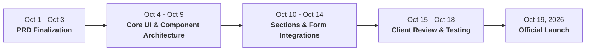

# Product Requirements Document (PRD)

> **Document Status:** Draft — Awaiting Client Review & Sign-Off  
> **Last Updated:** October 1, 2026  
> **Target Delivery Date:** October 19, 2026  
> **Product / Project:** FC 2015 Official Club Landing Page  
> **League / Tier:** Division Two (Greater Accra Regional FA, Ghana)  
> **Club Base / Stadium:** Legon, Accra  
> **Club Emblem & Mascot:** The Golden Eagle ("The Eagles")  
> **Document Owner:** Lead Product Engineer  

---

## 1. Executive Summary

### Product Name
**FC 2015 Official Club Landing Page** (`fc2015.com` / `2015fc.com`)

### Problem Statement
Founded in 2015 in Legon, Accra, **FC 2015** is an ambitious Division Two football club with a powerful visual identity (featuring its signature Golden Eagle crest in metallic gold and royal blue). Despite its growing talent pool and competitive ambition, the club currently lacks an authoritative, central web presence. Fan inquiries, player trial requests, local matchday schedules, and commercial sponsorship discussions are currently fragmented across informal messaging channels. This limits the club's ability to command respect from prospective corporate partners, scout top-tier regional players, and build an organized local supporter base.

### Proposed Solution
A modern, responsive, high-performance landing page that serves as the official digital headquarters of FC 2015. Incorporating design benchmarks from top-flight club portals (**Atlanta City FC**, **Arsenal FC**, and **Manchester United FC**), the landing page will blend high-energy sports visual storytelling with practical Division Two operational conversion paths: promoting home matches in Legon, signing up trialists, engaging local business sponsors, and showcasing official jerseys.

### Primary Conversion & Navigation
* **Primary Call to Action (CTA):** "Explore Club Story" / "About FC 2015" (directing visitors seamlessly to the club heritage and mission).
* **Secondary Action Paths:** "Matchday Fixtures & Results", "Register for Open Trials", and "Commercial Partnership Inquiry".

### Target Launch Date
**October 19, 2026** (18-day turnaround).

---

## 2. Verified Client Intake & Visual Asset Analysis

| Intake Attribute | Client Input | PRD & Design Implementation |
| :--- | :--- | :--- |
| **Official Club Name** | **FC 2015** (also referred to as *2015 FC*) | Standardized as **FC 2015** to match official crest lettering |
| **Year Established** | **2015** (Est. 2015) | Highlighted prominently in hero badge and club history timeline |
| **Home Ground & Base** | **Legon, Accra** | Displayed in match fixtures, venue directions, and hero |
| **League Division** | **Division Two** (GARFA League) | Focused on promotion ambition, grassroots talent, and local support |
| **Club Crest & Emblem** | Golden Eagle shield with star & blue/gold tri-bar | Hero-centered 3D metallic crest with deep midnight shield backdrop |
| **Official Colors** | **Imperial Gold & Royal Blue** | **Primary Gold:** `#E5A93C` / `#D4AF37` **Accent Blue:** `#0047AB` / `#0A3A82` **Base Dark:** `#0A0E17` / `#0F172A` |
| **Photography** | No photos available yet (use placeholders) | High-contrast, royalty-free athletic action & floodlit stadium placeholders |
| **Design Inspirations** | **Atlanta City FC (`atlcty.com`)** **Arsenal FC** & **Manchester United FC** | • **Atlanta City FC:** Dark sleek aesthetic, bold crest hero, founding community energy. • **Arsenal FC:** Clean, modern fixture cards and crisp typographic structure. • **Man United FC:** Prominent squad roster grid and commercial partner strip. |
| **Delivery Deadline** | **October 19, 2026** | Phased agile delivery with staging review by October 14 |

---

## 3. Goals & Success Criteria

### Business & Club Goals
1. **Elevate Brand Prestige:** Establish FC 2015 as the premier, digitally sophisticated Division Two club in Accra, signaling elite ambition to scouts, agents, and league officials.
2. **Standardize Player Recruitment:** Replace lost WhatsApp voice notes with a single structured Open Trials registration form.
3. **Attract Commercial Sponsors:** Provide a high-visibility partner strip to pitch local Accra businesses for kit and stadium banner deals.
4. **Drive Legon Matchday Attendance:** Make kickoff times, home venues, and match reports easily accessible to local supporters.

### User Goals
1. **Local Football Fans:** Quickly verify next match date, opponent, and Legon venue location.
2. **Aspiring Footballers (Ages 16–23):** Review trial eligibility rules and submit an application in under 2 minutes.
3. **Local Businesses & Sponsors:** Understand partnership exposure opportunities and connect with club management directly.

### Detailed Success Metrics

| Metric | Baseline | Target (30 Days Post-Launch) | Measurement Method |
| :--- | :--- | :--- | :--- |
| **Mobile Page Speed** | None (new site) | < 1.8 seconds on 4G networks | Google Lighthouse Score > 90 |
| **Open Trial Inquiries** | Unstructured chats | 50+ qualified player submissions | Lead database & email alerts |
| **Sponsorship Leads** | Word of mouth | 8+ commercial sponsor inquiries | Dedicated partner contact form |
| **Social Channel Growth** | Baseline followers | +35% traffic referral to Instagram/Facebook | UTM parameter tracking |

### Out of Scope (Non-Goals for v1 MVP)
* ❌ Automated online credit card payment gateway (kits showcased with direct WhatsApp order routing).
* ❌ Live play-by-play text commentary (static scoreboards and fixture countdowns instead).
* ❌ Member login portal (unnecessary technical overhead for Division Two launch).

---

## 4. User Personas & Core Journeys

### Persona 1: The Aspiring Trialist / Youth Recruit
* **Profile:** 17–21-year-old competitive footballer living in Accra looking for an opportunity in Division Two.
* **Goal:** Discover open trial dates, requirements (kit, registration fee if any, age limits), and sign up.
* **User Journey:** Lands on hero $\rightarrow$ Clicks "Open Trials" $\rightarrow$ Reviews trial dates and venue details $\rightarrow$ Fills short form (Name, Age, Preferred Position, Previous Club, WhatsApp #) $\rightarrow$ Receives instant confirmation and WhatsApp group link.

### Persona 2: The Matchday Supporter in Legon
* **Profile:** University student or resident in Legon passionate about local community football.
* **Goal:** Wants to know when the next home game is played and who is in the starting lineup.
* **User Journey:** Lands on hero $\rightarrow$ Views "Next Match Countdown" card $\rightarrow$ Checks venue details in Legon $\rightarrow$ Scrolls through First Team Squad to check player jersey numbers.

### Persona 3: The Local Business Sponsor
* **Profile:** Managing Director of an Accra-based enterprise (logistics, beverages, finance, hospitality).
* **Goal:** Evaluate whether FC 2015 has a serious brand identity worthy of a sponsorship investment.
* **User Journey:** Lands on site $\rightarrow$ Impressed by Atlanta City FC-caliber presentation and crest fidelity $\rightarrow$ Scrolls to "Official Partners" $\rightarrow$ Clicks "Become a Partner" $\rightarrow$ Initiates direct contact with club executives.

---

## 5. Functional Requirements (P0 MVP Scope)

All 8 sections selected in the client questionnaire are specified below with explicit acceptance criteria:

### 5.1 Hero Section
* **Function:** Establish immediate authority using the FC 2015 crest and club identity.
* **Elements:**
  * Official FC 2015 Golden Eagle crest prominently featured.
  * Headline: *"FC 2015 — The Pride of Legon"*.
  * Subtitle: *"Division Two Football Club | Est. 2015 | Legon, Greater Accra"*.
  * Primary Button: `"Explore Club Story"` (smooth scroll to About section).
  * Secondary Button: `"View Fixtures"` (smooth scroll to Match Center).
* **Acceptance Criteria:**
  * Hero renders without layout shift in < 1.2s on mobile.
  * Gold-and-blue accents match the metallic crest branding.

### 5.2 Match Center (Next Fixture & Recent Results)
* **Function:** Display matchday schedule inspired by Arsenal and Atlanta City FC match bars.
* **Elements:**
  * **Next Match Card:** Opponent placeholder crest, Date, Kickoff Time, Home Venue (*Legon, Accra*), and dynamic countdown timer (*Days : Hours : Mins*).
  * **Recent Results Strip:** Last 3 matches with scores, opponent names, and outcome badges (`WIN` / `DRAW` / `LOSS`).
* **Acceptance Criteria:**
  * Countdown timer automatically computes time to kickoff.
  * Venue information includes clear address in Legon, Accra.

### 5.3 First Team Squad Roster
* **Function:** Introduce first-team players and coaching staff.
* **Elements:**
  * Category filter: *All Players | Goalkeepers | Defenders | Midfielders | Forwards | Technical Staff*.
  * Player Card: Silhouette/sports placeholder image, kit number (e.g., #10, #7), player full name, position, and captain badge.
* **Acceptance Criteria:**
  * Interactive filter operates without page reload.
  * Cards display cleanly in a responsive grid (1 column on mobile, 3-4 on desktop).

### 5.4 Open Trials & Academy Registration
* **Function:** Structured funnel for recruiting fresh football talent in Ghana.
* **Elements:**
  * Trial briefing box: Age categories (U-17, U-19, Senior), trial guidelines, requirements.
  * Direct Registration Form: Full Name, Age / Date of Birth, Playing Position, Dominant Foot, Contact Phone / WhatsApp, Current Location.
  * Fallback CTA: `"Inquire via WhatsApp"`.
* **Acceptance Criteria:**
  * Form validates required inputs (valid phone number, non-empty name).
  * Submissions trigger notification email to club admin.

### 5.5 Club History & Milestones ("About FC 2015")
* **Function:** Tell the club's story from 2015 to the present.
* **Elements:**
  * Founding Story: Established in 2015 in Legon with a commitment to discipline and football excellence.
  * Crest Symbolism: The Golden Eagle (vision, strength, high ambition), the Star (excellence), and the Gold & Blue colors (victory and loyalty).
  * Milestone Timeline: 2015 Founding $\rightarrow$ Division Two League entry $\rightarrow$ Promotion campaign.
* **Acceptance Criteria:**
  * Smooth-scroll target for the primary Hero CTA button.

### 5.6 Official Kits & Merchandise Showcase
* **Function:** Showcase the team's visual identity and monetize club apparel.
* **Elements:**
  * **Home Uniform:** Royal Blue base with metallic gold trims and crest.
  * **Away Uniform:** Gold base with royal blue collar and trims.
  * Pre-Order Callout: *"Official 2015 Matchwear — Pre-Order for Available Sizes"*.
  * Button: `"Pre-Order via WhatsApp"` (pre-fills message with kit type).
* **Acceptance Criteria:**
  * Product cards display front kit visuals with clear pricing/inquiry details.

### 5.7 Official Sponsors & Partners Strip
* **Function:** Give visibility to current supporters and attract prospective commercial sponsors.
* **Elements:**
  * Sponsor logo strip with subtle hover animations.
  * Sponsor pitch box: *"Partner With FC 2015 — Align your business with Greater Accra's fastest rising Division Two football club."*
  * CTA: `"Download Partnership Deck / Inquire"`.
* **Acceptance Criteria:**
  * Clean, respectful layout accommodating multiple sponsor tiers.

### 5.8 Contact Hub & Social Channels
* **Function:** Centralize all incoming club communications.
* **Elements:**
  * Direct contact info: Official email (`TBD`), WhatsApp/Phone (`TBD`), Location: Legon, Accra.
  * Social Links: Instagram, Facebook, X/Twitter.
  * Quick Contact Form: Name, Email/Phone, Subject (Sponsorship, Trials, General), Message.
* **Acceptance Criteria:**
  * All social icons point to official club profiles.

---

## 6. Design System & Visual Benchmarks

Inspired by **Atlanta City FC (`atlcty.com`)**, **Arsenal FC**, and **Manchester United FC**:

### Color Palette
* **Imperial Gold (Primary Brand Accent):** `#E5A93C` / `#D4AF37` (crest border, button highlights, badges)
* **Royal Athletic Blue (Accent Brand Color):** `#0047AB` / `#0A3A82` (crest center bar, secondary badges, active tabs)
* **Midnight Pitch Black (Background & Base):** `#0A0E17` / `#0F172A` (deep atmospheric background)
* **Elevated Card Surface:** `#161F30` (modular cards, fixture containers)
* **Crisp Text:** `#FFFFFF` (Headlines) & `#94A3B8` (Body & Muted Metadata)

### Typography
* **Primary Athletic Display:** `Oswald` / `Montserrat` (bold, condensed, uppercase for headers and scores, identical to `atlcty.com`).
* **Interface & Body:** `Inter` / `Roboto` (high legibility for forms, match tables, and story paragraphs).

### Imagery & Placeholder Treatment
* High-definition sports stock photography with dark-navy gradient vignettes (`rgba(10, 14, 23, 0.85)`).
* The official cropped **FC 2015 Golden Eagle Crest** (`assets/fc_2015_crest.png`) as the hero centerpiece.

---

## 7. Technical & Non-Functional Specifications

* **Responsive Design:** Mobile-first architecture tested across standard iOS Safari and Android Chrome viewports.
* **Load Performance:** Target First Contentful Paint < 1.2s; total page weight < 2.0MB.
* **SEO & Social Sharing:**
  * Title: `FC 2015 | Official Division Two Football Club | Legon, Accra`
  * Description: `Welcome to the official digital home of FC 2015, Division Two club based in Legon, Accra. Check upcoming match fixtures, squad rosters, open trial dates, and partnership opportunities.`
  * OpenGraph image: Dedicated 1200x630px social banner featuring the Golden Eagle crest.
* **Security & Form Protection:** Client-side rate limiting and spam protection on the trial registration form.

---

## 8. Implementation Roadmap (Launch: October 19, 2026)

| Phase | Milestone Description | Target Date | Status |
| :--- | :--- | :--- | :--- |
| **Phase 1** | PRD Specification & Client Sign-Off | October 2, 2026 | **Under Review (Awaiting Client Approval)** |
| **Phase 2** | Design Tokens, Crest Integration & Hero Section | October 6, 2026 | Pending PRD Sign-Off |
| **Phase 3** | Match Center, Squad Grid & Trials Form | October 11, 2026 | Scheduled |
| **Phase 4** | Kit Showcase, Sponsors & About Section | October 14, 2026 | Scheduled |
| **Phase 5** | Staging Review with Client & Final Polish | October 17, 2026 | Scheduled |
| **Phase 6** | Production Deployment & Go-Live | October 19, 2026 | Scheduled |

---

*Document submitted for FC 2015 leadership review and approval prior to implementation.*
