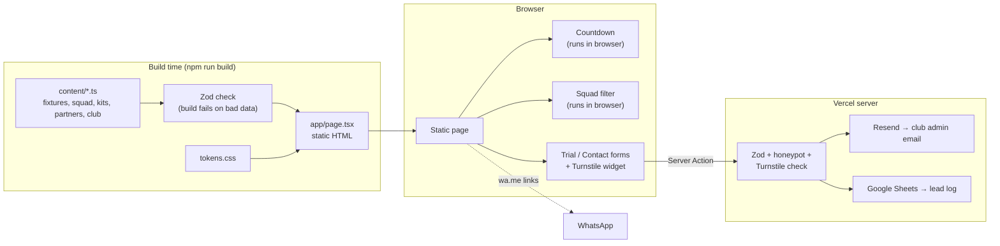

# Technical Design Document (TDD): FC 2015 Official Landing Page

> **Status:** Draft v1.0, for review by the lead engineer
> **Date:** 3 October 2026 · **Launch:** 19 October 2026 (16 days)
> **Inputs:** [PRD.md](../product/PRD.md) (signed, fully confirmed by the client) · [DESIGN_TOKENS.md](../design/DESIGN_TOKENS.md) + [tokens.css](../../styles/tokens.css) (v2.0) · [SITE_BLUEPRINT.md](../design/SITE_BLUEPRINT.md) (section wireframes + placeholders)
> **Readers:** the lead engineer, and coding agents building single tickets from §12

**How to use this document:** The PRD says *what* the site must do. This document says *how* it gets built. When the two conflict, the PRD wins on scope and this document wins on implementation. Every ticket in §12 links back to a PRD section.

---

## 1. Summary of decisions

| Area | Decision | Why |
| :--- | :--- | :--- |
| Framework | **Next.js 16** (latest 16.x), App Router, TypeScript strict mode | Image and font optimisation help hit the PRD speed targets. Server Actions handle the forms without a separate backend. There's room to add real pages later. |
| Rendering | The whole page is **pre-rendered as static HTML at build time**. Only two parts run in the browser: the countdown and the squad filter. | First Contentful Paint (FCP) under 1.2s is easiest when the page is static HTML. Content changes once a week at most. |
| Styling | **CSS Modules + `tokens.css`**. No Tailwind. | The tokens are already CSS variables in three tiers, so CSS Modules can use them directly without a translation layer. A lint rule enforces "only `--s-`/`--c-` tokens", which stops agents inventing colours. |
| Content | **Typed TypeScript files** in `content/`, checked with Zod at build time. No CMS in v1. | Rosters and fixtures are short lists. A CMS is more work than this deadline allows. See §11 open question Q7. |
| Forms | **Server Actions** with **Zod** validation shared by client and server. The forms still work with JavaScript disabled. | One schema, so client and server never disagree about what's valid. |
| Spam protection | **Cloudflare Turnstile** + a hidden honeypot field + a minimum fill time | Free, with no image puzzles for users. Checked on the server, which matters more than the PRD's "client-side rate limiting". |
| Email | **Resend**: an alert to the club admin for every submission | The free tier is 3,000 emails/month (100/day), far more than we need. Needs a verified domain. |
| Lead storage | **Google Sheets** (one sheet per form), written to with a service account | The PRD's success metrics need a lead database. A spreadsheet is free, never pauses, and club staff can read it without a dashboard. |
| Hosting | **Vercel Pro** ($20/month). The club is being informed. The client already owns its domain. | Vercel's free Hobby plan forbids commercial sites, and a club with sponsors and kit sales is commercial. |
| Analytics | **Vercel Web Analytics + Speed Insights** | Tracks clicks out to social media (PRD social-growth metric) and real-user page speed. Included with Pro. |
| Testing | Vitest + Testing Library (unit tests), Playwright + axe (end-to-end and accessibility), Lighthouse CI (speed budget) | Each PRD acceptance criterion maps to an automated check (§9). |

---

## 2. Architecture



**Rule:** the page reads no database at request time. Every visitor gets the same pre-built HTML from the CDN. The only server code is the two form actions.

---

## 3. Repository layout

```
fc2015-web/                     # the shared Git repo (GitHub → Vercel)
├─ app/
│  ├─ layout.tsx                # fonts (next/font), metadata, header, footer, analytics
│  ├─ page.tsx                  # puts the sections together (blueprint §2 order) + JSON-LD
│  ├─ globals.css               # @import tokens; reset; base element styles
│  ├─ privacy/                  # privacy and cookie notice
│  ├─ actions/                  # submit-trial.ts, submit-contact.ts ('use server')
│  ├─ api/rebuild/route.ts      # daily rebuild endpoint (Vercel Cron)
│  ├─ opengraph-image.png · icon.png · apple-icon.png
│  └─ sitemap.ts · robots.ts
├─ components/
│  ├─ sections/                 # one folder per section: Section.tsx + Section.module.css
│  └─ ui/                       # Button, Field, SectionHeading, Countdown, KitRender, FormGuard…
├─ content/                     # the only place site content lives (§5)
├─ lib/                         # pure logic (tested) + lib/server/ (email, sheets, Turnstile)
├─ styles/tokens.css            # design tokens: the single source of truth
├─ public/                      # brand/, images/ (served files)
├─ assets-src/                  # originals: client crest and logo, stock photos, fonts, CREDITS.md
├─ scripts/                     # duotone.mjs, check-launch.mjs
├─ tests/                       # unit/ (Vitest), e2e/ (Playwright)
├─ docs/
│  ├─ product/                  # PRD.md (signed), PRD.pdf
│  ├─ technical/                # TDD.md (this file)
│  ├─ design/                   # DESIGN_TOKENS.md, SITE_BLUEPRINT.md, references/ (site screenshots)
│  └─ client/                   # questionnaire and discovery guide from the client intake
├─ .github/                     # CI workflow, pull request template
├─ AGENTS.md · CLAUDE.md        # rules for coding agents
└─ CONTRIBUTING.md              # how the two of us work together
```

Kept **outside** the repo, in each developer's local `_local/` folder: Antigravity's first prototype, the Python capture scripts, and the 126 MB of captured Arsenal, Man United and Atlanta City site code. The captures are other clubs' copyrighted code and are only needed to re-check a token's source.

---

## 4. Design system integration

- `styles/tokens.css` is imported once, from `app/globals.css`. Components use **only** `var(--s-*)` and `var(--c-*)`.
- **Linting (Stylelint):** fail on any hex, `rgb()`/`hsl()`, named colour or `var(--p-color-*)` inside `*.module.css`. Spacing, radius and type primitives (`--p-space-*`, `--p-size-text-*`) are allowed in components. `globals.css` and `tokens.css` are exempt. Media queries keep the `min-width` form so older iOS Safari (below 16.4) is supported.
- **Fonts:** load them in `app/layout.tsx` with `next/font/google`:
  - `Oswald` 700 → `variable: '--font-oswald'`
  - `Inter` 400/500/600/700 → `'--font-inter'`
  - `Fraunces` 600 italic → `'--font-fraunces'`
  - All with `subsets: ['latin']` and `display: 'swap'`. Put the three variables' classes on `<html>`.
- **Breakpoints:** CSS variables can't be used in `@media`, so the values are written out in media queries: `768px`, `1024px`, `1440px`. Write styles for mobile first and use `min-width` queries.
- **Surfaces:** a section that needs the gold or blue treatment sets `data-surface="gold"` or `"blue"` on its root element (§6). Don't create colour variants of components.
- **Crest:** the PNG has a black square background (DESIGN_TOKENS §7). Ticket T1b makes a transparent cutout (blueprint §4.7), and every component uses that. `mix-blend-mode: lighten` is only the fallback if the cutout isn't ready in time for T3.

---

## 5. Content model

All content is typed, checked at build time, and comes from the client. **Agents must never invent content.** Unknown values use the `TBD()` placeholder below, so they can be found with a search before launch.

```ts
// content/schema.ts (abridged)
export const Fixture = z.object({
  id: z.string(),
  opponent: z.string(),
  opponentShort: z.string().max(3),           // for the placeholder crest monogram
  opponentCrest: z.string().optional(),        // /images/opponents/*.svg
  competition: z.string(),                     // e.g. "GARFA Division Two"
  kickoff: z.string().datetime({ offset: true }), // ISO-8601, e.g. 2026-10-25T15:00:00Z
  venue: z.object({ name: z.string(), address: z.string(), mapsUrl: z.string().url() }),
  home: z.boolean(),
  result: z.object({ for: z.number().int(), against: z.number().int() }).optional(),
});

export const Person = z.object({
  id: z.string(),
  name: z.string(),
  role: z.enum(['GK', 'DF', 'MF', 'FW', 'STAFF']),
  staffTitle: z.string().optional(),           // "Head Coach" (when role is STAFF)
  number: z.number().int().min(1).max(99).optional(),
  captain: z.boolean().default(false),
  photo: z.string().optional(),                // falls back to a silhouette
});

export const Kit = z.object({
  id: z.enum(['home', 'away']), name: z.string(), description: z.string(),
  image: z.string(), priceGHS: z.number().optional(),   // undefined → "Price on enquiry"
  sizes: z.array(z.string()),
});

export const Partner = z.object({
  name: z.string(), tier: z.enum(['principal', 'official', 'supporter']),
  logo: z.string(), url: z.string().url().optional(),
});

export const Club = z.object({
  email: z.string().email(), whatsapp: z.string().regex(/^233\d{9}$/), // international format, no +
  trialsWhatsappGroup: z.string().url(),
  socials: z.object({ instagram: z.string().url(), facebook: z.string().url(), x: z.string().url() }),
  address: z.string(),                          // "Legon, Accra"
});
```

**Derived values (computed, never written by hand):**
- **Next match:** the earliest fixture with `kickoff > now` at build time. **Recent results:** the 3 latest fixtures that have a `result`. **WIN/DRAW/LOSS** is calculated from the score.
- **A rebuild is needed after every match day** to update results and the next fixture. This can be automated (§8, daily rebuild), but new results still need a content commit. See Q7.

**Time zone:** Accra is UTC+0 with no daylight saving. Kickoffs are stored in ISO format with a `Z` and shown with `Intl.DateTimeFormat('en-GH', { timeZone: 'Africa/Accra' })`.

**`TBD()` helper:** `TBD('whatsapp number')` returns a value that passes type checks. A **pre-launch check in CI fails if any `TBD(` is left** in `content/` (§9).

---

## 6. Section specifications

**Layout, wireframes and placeholders for every section are in [SITE_BLUEPRINT.md](../design/SITE_BLUEPRINT.md) §3–4.** This section covers behaviour and data. Page order (blueprint §2): Hero → Match Center → About → Squad → Trials → Kits → Partners → Contact. Each one is a static (server-rendered) component unless marked *[runs in browser]*. Its root is `<section id="…" aria-labelledby="…">` so anchor links work. The anchor ids are fixed: `#top #matches #squad #trials #about #kits #partners #contact`.

### 6.0 Site header and footer
- **Header:** sticky, `--c-nav-bg`, height `--s-layout-nav-height`. It holds the crest and wordmark, links to the anchors, and one gold primary button ("Join Open Trials" → `#trials`). The active link gets a 3px gold bar underneath, set by an `IntersectionObserver` *[runs in browser, small]*.
  - Below 1024px it becomes a menu button that opens a full-screen sheet. It traps keyboard focus, closes with Esc, and has `aria-expanded` set correctly.
- **Footer:** `--s-color-bg-sunken`. It has the crest, the anchor links again, social icons, "© 2026 FC 2015 · Legon, Accra", and a link to the privacy notice (§10).
- **Partner strip at the very top:** **not in v1.** AG's prototype invented sponsor names. The partners section (§6.7) handles sponsors.

### 6.1 Hero (PRD §5.1)
- **Layout:** full-width placeholder photo (floodlit pitch or players, licensed, saved in `/public`), `--s-scrim-left` over it, at least 100svh tall on mobile and 88svh on desktop.
- **Content, as the PRD says:** the crest, an H1 "FC 2015 — The Pride of Legon" in `display-xl`, the subtitle "Division Two Football Club | Est. 2015 | Legon, Greater Accra" in `label`, and two buttons: primary "Explore Club Story" → `#about` and secondary "View Fixtures" → `#matches`.
- **Next-match strip:** a one-line strip at the bottom edge ("NEXT: FC 2015 v [OPPONENT] · SAT 25 OCT · 15:00 · LEGON"), set as type, not as a card. It links to `#matches`.
- **Not allowed** (DESIGN_TOKENS §6): glass cards, glow effects, gradient blobs, invented opponents or matchday numbers.
- **Speed:** the hero image uses `next/image` with `priority`, `sizes="100vw"`, AVIF, under 180 KB at 1440w, and a fixed aspect ratio so nothing shifts while it loads. The H1 text renders straight from the server, so it doesn't wait for JavaScript.

### 6.2 Match Center (PRD §5.2)
- **Next-match card:** both crests (an opponent without a crest gets a monogram from `opponentShort`), competition, date, kickoff time, venue name and address, and a "Directions" link to Google Maps.
- **Countdown** *[runs in browser]*: shows days, hours, minutes and seconds.
  - The server renders the date as a fixed string, so the page never mismatches between server and browser. After loading, the countdown ticks every second.
  - It uses `font-variant-numeric: tabular-nums` so the digits don't jump. Screen readers get a label that only updates once a minute ("Kick-off in 5 days 14 hours").
  - When it reaches zero it shows "Kick-off". After kickoff + 2 hours it shows "Full time — result to follow".
- **Recent results:** the last 3 matches as rows with date, opponent, score and a WIN/DRAW/LOSS badge. The badge has a text label as well as a colour (`--s-color-result-*`).
- **Logic:** `lib/countdown.ts` is a pure function `diff(kickoffISO, nowMs) → {d,h,m,s,state}` with unit tests.

### 6.3 Squad (PRD §5.3)
- **Filter** *[runs in browser]*: All, Goalkeepers, Defenders, Midfielders, Forwards, Technical Staff. It's a row of toggle buttons (`aria-pressed`), not tabs. The page doesn't reload. The current filter is saved in the URL (`?squad=DF`), so a filtered view can be shared and the back button works.
- **All cards are in the HTML from the start.** Filtering only hides cards, so search engines and no-JavaScript visitors still see the whole squad.
- **Card:** 3:4 ratio, photo or silhouette, the kit number as a large faded watermark (`--c-player-number-color`), name, position tag, and a captain badge "C" with the label "Captain".
- **Grid:** 1 column under 768px, 2 at 768px, 3 at 1024px, 4 at 1440px. *The PRD says 1 column on mobile. Two columns at 360px may fit better; decide at design review.*

### 6.4 Open Trials (PRD §5.4): the most important conversion
- **Briefing panel:** age groups (U-17, U-19, Senior), trial dates and venue, what to bring, and eligibility (ages 16–23 per PRD §3). All of it comes from `content/trials.ts`.
- **Form fields.** This is the combined set from PRD §4 and §5.4, which list different fields. The client should confirm it (Q4):

| Field | Type | Rule |
| :--- | :--- | :--- |
| Full name | text | Required, 2–80 characters |
| Date of birth | date | Required. Age on the trial date must be 16–23 (PRD §3). The age group (U-17, U-19, Senior) is calculated from it. |
| Playing position | select (GK/DF/MF/FW) | Required |
| Dominant foot | radio (Left/Right/Both) | Required |
| Previous club / academy | text | Optional |
| WhatsApp / phone | tel | Required. Ghana format, normalised to `233XXXXXXXXX`. Accepts `0XXXXXXXXX`, `+233XXXXXXXXX` and `233XXXXXXXXX`, where the digit after the prefix is 2, 3 or 5. |
| Current location | text | Required |
| Guardian name + phone | text, tel | **Required only when under 18** (§10) |
| Consent | checkbox | Required ("I agree FC 2015 may contact me about trials…") |
| *(hidden)* honeypot, start timestamp, Turnstile token | — | Server checks |

- **Success:** the form is replaced by a confirmation, focus moves to its heading, and it shows "Join the trials WhatsApp group" (`club.trialsWhatsappGroup`). This is the PRD §4 "instant confirmation and WhatsApp group link".
- **Errors:** each error appears next to its field and is announced by screen readers. A summary at the top links to each failing field. Whatever the user typed stays filled in.
- **Fallback button:** "Inquire via WhatsApp" opens wa.me with a pre-filled message.
- **Server flow** (`submit-trial.ts`):
  1. Check the honeypot. If it's filled, pretend the submission succeeded.
  2. If the form was filled in under 3 seconds, reject it. The start time is added by the browser at submit time, not held in a hidden field, because React clears form fields after each action.
  3. Validate with Zod. This comes *before* the human check, so people always see their own mistakes first.
  4. Check the Turnstile token on the server.
  5. Append the row to the Trials sheet and send an email through Resend to `CLUB_ADMIN_EMAIL` (subject: `[Trials] Name — Position, Age group`), in parallel.
  6. Return the result.
  - **Submit button:** stays disabled ("Checking you're human…") until Turnstile issues a token. If Cloudflare can't be reached it unlocks after 12 seconds and the server explains the problem. Both forms share one Turnstile script loader; two separate `next/script` tags left the second form without a widget.
  - **If either the sheet write or the email fails:** log it, and still show success as long as one of them worked. Only show an error when both fail ("Please message us on WhatsApp").

### 6.5 About / History (PRD §5.5)
- This is where the hero's primary button scrolls to (`#about`).
- **Founding story:** `editorial-l` intro line (Fraunces), then body text. **Crest symbolism:** three items (Golden Eagle, Star, Gold & Blue). **Timeline:** 2015 founding → entry to Division Two → promotion campaign, as an ordered list (`<ol>`) laid out horizontally on desktop and vertically on mobile.
- **The client supplies the copy.** Agents write nothing beyond the PRD wording until then.

### 6.6 Kits (PRD §5.6)
- Can sit on `data-surface="blue"`. There are two cards (home and away) with an image, name, description, sizes, and the price or "Price on enquiry".
- **Button:** "Pre-Order via WhatsApp" builds the wa.me link through `lib/whatsapp.ts`, with the text "Hello FC 2015, I'd like to pre-order the {Home|Away} kit. Size: ___".
- **Kit images:** vector kit renders (blueprint §4.1a) until there are product photos.

### 6.7 Partners (PRD §5.7)
- **Logos grouped by tier.** Principal partners get large logos, the other tiers smaller ones. Logos are at 60% opacity and grayscale, and turn full colour on hover or focus.
- **If there are no partners yet:** the section shows only the pitch box. Never show placeholder or invented brands.
- **Pitch box** (`data-surface="gold"`, the page's one gold band): the PRD copy, a "Download Partnership Deck" link (PDF, shows its file size) and an "Inquire" button. "Inquire" goes to `#contact` with the subject set to Sponsorship (`?subject=sponsorship`, read by the contact form).

### 6.8 Contact (PRD §5.8)
- **Contact details:** email (`mailto:`), WhatsApp (`wa.me`), location with a maps link, and social icon links. Each icon has an `aria-label`, and links use `rel="noopener"`.
- **Form:** name, email *or* phone (at least one required), subject (Sponsorship / Trials / General), message (10–2000 characters).
  - It goes through the same server checks as the trials form → Contact sheet → email with subject `[Contact:{subject}]`.

---

## 7. SEO, metadata, social

- `metadata` in `layout.tsx`: the title and description written word for word as in PRD §7, `metadataBase` = production URL, canonical URL, Open Graph and Twitter cards, and `opengraph-image.png` at 1200×630 (crest on black with the wordmark).
- **Structured data (JSON-LD):** `SportsTeam` (name, sport "Soccer", location Legon, Accra, logo, `sameAs` = social links), plus a `SportsEvent` for the next fixture.
- `sitemap.ts` (one URL) and `robots.ts` (allow all, link to the sitemap).
- `lang="en-GH"` on `<html>`.

---

## 8. Infrastructure and environments

| Environment | URL | Deploys when |
| :--- | :--- | :--- |
| Preview | `*.vercel.app` per pull request | A pull request opens or updates |
| Staging | `staging.<domain>` (or a pinned preview URL) | Merge to `main`. **The client reviews here from 14 Oct.** |
| Production | `<domain>` (Q2: fc2015.com or 2015fc.com) | Manual promote, launching 19 Oct |

**Environment variables** (set in Vercel, never committed):

```
NEXT_PUBLIC_SITE_URL
NEXT_PUBLIC_TURNSTILE_SITE_KEY      TURNSTILE_SECRET_KEY
RESEND_API_KEY                      MAIL_FROM=FC 2015 Website <web@<domain>>
CLUB_ADMIN_EMAIL                    # where submissions go (Q3)
GOOGLE_SERVICE_ACCOUNT_EMAIL        GOOGLE_PRIVATE_KEY
SHEETS_SPREADSHEET_ID               # tabs: Trials, Contact
CRON_SECRET                         DEPLOY_HOOK_URL     # daily rebuild
FORMS_DRY_RUN=1                     # tests only; ignored on Vercel production
```

- **DNS:** the domain must be bought and its DNS managed by **10 Oct**. Resend's domain verification (SPF/DKIM) and the Vercel domain both depend on it.
- **Daily rebuild:** a Vercel Cron job (`vercel.json`) calls `/api/rebuild` every day at 00:05 UTC, which checks `CRON_SECRET` and triggers the Deploy Hook. That keeps "next match" correct after a kickoff passes, even with no content change.
- **Security headers** (`next.config.ts`):
  - Content Security Policy allowing `self`, `challenges.cloudflare.com` (Turnstile) and Vercel analytics
  - `X-Content-Type-Options: nosniff`
  - `Referrer-Policy: strict-origin-when-cross-origin`
  - `Permissions-Policy` that disables camera, microphone and location

---

## 9. Quality, testing and budgets

**Continuous integration** (GitHub Actions, on every pull request) runs `typecheck → lint (ESLint + Stylelint) → unit tests → build → Playwright tests against the built site → Lighthouse CI`.

| PRD requirement | Automated check |
| :--- | :--- |
| Countdown calculates time to kickoff (§5.2) | Unit: `countdown.diff` at the boundaries (zero, after kickoff, full time). E2E: shows a future time with the clock mocked. |
| Venue address shown (§5.2) | E2E: Match Center contains `club.address` |
| Filter works without a reload (§5.3) | E2E: click "Defenders" → only DF cards visible, URL has `?squad=DF`, no page navigation |
| Grid columns (§5.3) | E2E: count card columns at 360 / 1024 / 1440 |
| Trial form validates phone and name (§5.4) | Unit: Zod tests on Ghana number formats (valid and invalid). E2E: empty submit shows errors and focus moves to the summary. |
| Submissions notify the admin (§5.4) | E2E: Resend and Sheets mocked in test mode, assert they were called with the expected data. A real email is sent once on staging. |
| Hero button scrolls to About (§5.5) | E2E: click → `#about` is in view |
| Kit WhatsApp message pre-filled (§5.6) | Unit: `whatsapp.ts` link building and encoding |
| Social links point to the official profiles (§5.8) | Pre-launch: no `TBD(` left. E2E: every social `href` matches `club.socials` |
| Accessibility | E2E: **axe** finds no serious or critical issues. Keyboard-only run through every form. |
| Speed (§3, §7) | **Lighthouse CI, mobile, simulated 4G:** Performance ≥ 90, FCP ≤ 1.2s, LCP ≤ 1.8s, CLS ≤ 0.05. **Page weight ≤ 2.0 MB**, JavaScript ≤ 120 KB gzipped. |

**Manual checks before launch:**
- Test on real devices: iPhone with Safari, and a mid-range Android phone with Chrome on a Ghanaian 4G network.
- Submit both forms end to end on staging and confirm the email arrives and the sheet row appears.

---

## 10. Security and privacy

- **Every form is checked on the server.** Client-side checks are only there for convenience. The PRD's "client-side rate limiting" becomes a button disabled during submit plus a 30s cooldown, while the real protection is Turnstile + honeypot + fill-time check on the server.
- **If abuse shows up after launch:** add per-IP rate limiting (Upstash Ratelimit) in v1.1.
- **Ghana Data Protection Act, 2012 (Act 843).** The trial form collects personal data, including from 16- and 17-year-olds. In response:
  - The **consent checkbox** is required.
  - **Guardian name and phone** are required when the applicant is under 18.
  - There's a short **privacy notice** (who stores the data, why, how long it's kept, and a contact for deletion requests). The sheet is shared only with named club staff.
  - The client must confirm the guardian requirement and the retention period (Q8).
- **No secrets in the browser.** Only the Turnstile site key uses the `NEXT_PUBLIC_` prefix.
- **Email bodies escape user input.** They're built with React Email or plain-text templates, never by joining raw strings into HTML.

---

## 11. Open questions (blocking items in **bold**)

| # | Question | Owner | Needed by | Default if no answer |
| :--- | :--- | :--- | :--- | :--- |
| ~~Q1~~ | ~~Hosting~~ **Decided:** Vercel Pro. Client being informed. | — | — | — |
| **Q2** | **Domain:** the client owns it. We need the exact name and DNS access (for Vercel + Resend). | Client | 10 Oct | — (blocks email and launch) |
| **Q3** | **Club email, WhatsApp number, admin notification email, trials WhatsApp group link.** To be requested later. | Client | 15 Oct | — (blocks launch) |
| ~~Q4~~ | ~~Trial form fields~~ **Decided:** PRD confirmed. We ship the combined §4 + §5.4 list in §6.4. | — | — | — |
| **Q5** | **Real content:** fixtures and results, squad list, kit prices and sizes, partner logos, trial dates and venue, club story, partnership deck PDF. To be requested later. | Client | 15 Oct | Placeholders from blueprint §4. No fake names, brands or results go live. |
| **Q6** | **Transparent crest** (PNG/SVG) and which blue the kits use (`#0047AB` vs the crest's `#0024A0`) | Client | After launch | Our cutout (T1b), PRD blue |
| Q7 | Who updates fixtures and results each week? If a non-developer, plan a CMS (Sanity or Keystatic) for v1.1 | Client | Launch | A developer updates via commit |
| Q8 | Data retention period. Guardian consent for under-18s. | Client | 12 Oct | 12 months; guardian required |
| Q9 | Real photography (player shoot spec in blueprint §4.3) | Client | After launch | Duotone stock + designed placeholders (blueprint §4) |

---

## 12. Delivery plan and tickets

Each ticket is a self-contained unit for one agent or developer. It is **done** only when its checks from §9 pass in CI. Dates line up with the signed PRD phases.

| Ticket | Scope | PRD | Depends on | Target |
| :--- | :--- | :--- | :--- | :--- |
| **T0** Scaffold | `create-next-app` (TS, App Router, ESLint), npm, tokens in `styles/`, `globals.css`, fonts, Stylelint rule, Vitest, Playwright, CI, Vercel project + preview | §7 | — | 4 Oct |
| **T1** UI primitives | Button, Badge, Card, Field/Select/Radio, SectionHeading, `data-surface` check page at `/dev/specimen` (excluded from search engines) | — | T0 | 5 Oct |
| **T2** Content layer | `content/schema.ts`, sample files using `TBD()`, derived next match and results, pre-launch `TBD` check | — | T0 | 5 Oct |
| **T1b** Brand assets | Crest cutout, player silhouette, kit renders, monogram crest, crest icons, brand pattern, share image, stock shortlist → duotone script (blueprint §4) | — | — | 5 Oct |
| **T3** Header, footer, hero | §6.0, §6.1 to blueprint §3.0, §3.1, §3.9 | 5.1 | T1, T1b, T2 | **6 Oct (Phase 2)** |
| **T4** Match Center | §6.2, `countdown.ts` + tests | 5.2 | T1, T2 | 8 Oct |
| **T5** Squad | §6.3, filter with URL state | 5.3 | T1, T2 | 9 Oct |
| **T6** Trials form | §6.4 end to end: schema, Server Action, Turnstile, Resend, Sheets, success and error states | 5.4 | T1, T2 | **11 Oct (Phase 3)** |
| **T7** About | §6.5 | 5.5 | T1 | 12 Oct |
| **T8** Kits | §6.6, `whatsapp.ts` + tests | 5.6 | T1, T2 | 12 Oct |
| **T9** Partners | §6.7, gold surface band, deck download | 5.7 | T1, T2 | 13 Oct |
| **T10** Contact | §6.8, reuses T6's form pipeline, subject prefill via `#contact-sponsorship` (a hash link, so no page reload) | 5.8 | T6 | **14 Oct (Phase 4)** |
| **T11** SEO and speed | §7 metadata, OG image, JSON-LD, sitemap, security headers, Lighthouse budget passing | §7 | T3–T10 | 14 Oct |
| **T12** Staging review | Client walkthrough, swap in real content (Q5), fix list | — | T11 | **15–17 Oct (Phase 5)** |
| **T13** Launch | DNS cut-over, production env vars, real form test, analytics check, `TBD` check green | — | T12 | **19 Oct (Phase 6)** |

**Rules for agents** (paste these into every ticket prompt):
1. Build **only** the ticket's scope. Don't touch other sections, and don't start the next ticket.
2. **Don't invent content.** Every name, date, price, sponsor and phone number comes from `content/`. If it's missing, use `TBD()` and the section's no-data state.
3. Styles use only `var(--s-*)` and `var(--c-*)`. No hex colours, no `--p-*`, no Tailwind, no new fonts.
4. Follow DESIGN_TOKENS.md §6. No glassmorphism, glow shadows or decorative gradients.
5. A ticket is finished when the §9 checks pass in CI and a screenshot at 360, 1024 and 1440px is attached to the pull request.

The same rules, plus Next.js 16 specifics, are in `AGENTS.md` at the repo root, which coding agents read automatically.

### Build status (11 Oct 2026)

**Restructured into a multi-page site** after the design vote ([DECISIONS.md](../design/DECISIONS.md)): `/`, `/club`, `/squad`, `/matches`, `/trials`, `/kits`, `/partners`, `/contact`, `/privacy` and a themed 404, all pre-rendered as static pages.
- **New pieces:** Club ▾ dropdown, Last/Next/Upcoming match cards, squad row, Arsenal-style squad page, "Behind the crest" explorer, colour cards, timeline, trial steps, fixtures list.
- **Social links:** an icon appears only for accounts the club has given us.
- **Checks:** 34 unit tests and 49 browser tests pass, with an accessibility scan on every page.
- **Still open:** the colour direction (light / mixed / dark) and the Lighthouse measurement on a Vercel preview.

### Build status (7 Oct 2026)

T0–T10 are built (this repo). Typecheck, ESLint and Stylelint are clean, 34 unit tests pass, and 31 Playwright tests pass on desktop and mobile Chrome, including the axe accessibility check. Still open:

- **T1:** the `/dev/specimen` token page was not built.
- **T11:** metadata, share image, JSON-LD, sitemap, robots and security headers are done. The **Lighthouse budget has not been measured yet**; it needs a deployed preview URL.
- **T12–T13:** need the client's content and accounts (Resend, Google service account, Turnstile keys, Deploy Hook). `npm run check:launch` lists every placeholder still in the site.

---

## 13. Out of scope for v1 (from PRD §3)

Online card payments (kits are ordered through WhatsApp), live match commentary, member login, news/blog, multiple pages, CMS (see Q7), and multiple languages.
